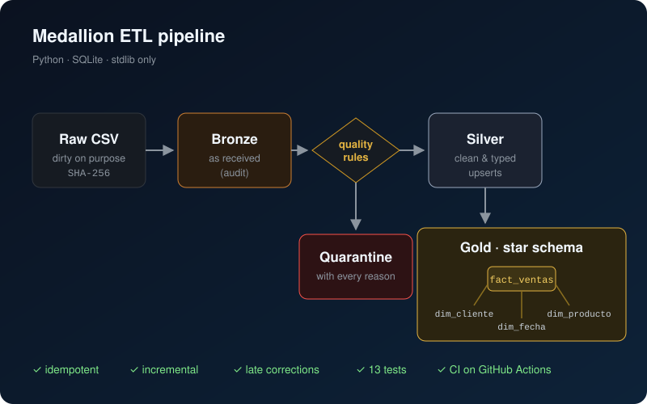
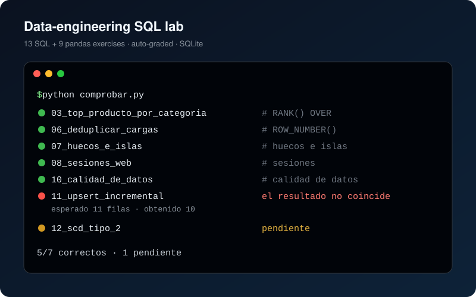

<p align="center">
  
</p>

<p align="center">
  <a href="https://salmerondevzone.github.io"></a>
  <a href="https://www.linkedin.com/in/jesussalmeronarmario/"></a>
  <a href="mailto:jsalmedev@gmail.com"></a>
</p>

## 👋 About me

I'm a **Data Engineer at T-Systems Iberia**. I build the pipelines that turn raw, messy data into tables people can trust: ingestion, cleansing, data quality, dimensional models and the SQL on top, on **Microsoft Fabric**, **Spark** and **SQL Server / Oracle**.

Now I'm taking that into **DevOps & Platform Engineering**: the same mindset (automate it, test it, observe it) applied to infrastructure on **Azure**.

```yaml
# whoami.yaml
name: Jesús Salmerón
role: Data Engineer @ T-Systems Iberia
next: DevOps / Platform Engineering
data: [PySpark, Microsoft Fabric, SQL, Python, SSIS]
devops: [Azure, Terraform, Docker, Kubernetes, CI/CD]
motto: "If it isn't tested and automated, it isn't done."
```

## 🧪 What I do as a Data Engineer, with proof

Every claim links to code you can run.

| Skill | See it in action |
| --- | --- |
| **Medallion pipelines**: bronze → silver → gold, idempotent and incremental, with late-arriving corrections | [Insight_Horizon · pipeline](https://github.com/SalmeronDevZone/Insight_Horizon/tree/main/pipeline) |
| **Data quality**: validation rules, quarantine with every reason, quality reports | [Insight_Horizon](https://github.com/SalmeronDevZone/Insight_Horizon/tree/main/pipeline) · [Go data-quality CLI](https://github.com/SalmeronDevZone/PythonProjects/tree/main/Go/Proyecto%20Final) |
| **Advanced SQL**: window functions, gaps & islands, sessionization, upserts, SCD type 2, recursive CTEs | [snake-data-lair · 13 auto-graded exercises](https://github.com/SalmeronDevZone/snake-data-lair/tree/main/ejercicios) |
| **SQL across engines**: T-SQL, PL/SQL, MySQL, SQLite and a star schema for a Fabric warehouse | [snake-data-lair · SQL](https://github.com/SalmeronDevZone/snake-data-lair/tree/main/SQL) |
| **Spark on a Lakehouse**: explicit schemas, partitioned Parquet, Delta tables, Spark SQL | [PythonProjects · FABRIC](https://github.com/SalmeronDevZone/PythonProjects/tree/main/FABRIC) |
| **Python for data**: pandas, generators, CDC, retries with backoff, API pagination, idempotent ingestion | [PythonProjects · exercises](https://github.com/SalmeronDevZone/PythonProjects/tree/main/ejercicios) |
| **Engineering habits**: tests and CI in every repository, Git workflows | [Git labs](https://github.com/SalmeronDevZone/GitHub/tree/main/ejercicios) · the green badges in each README |

## 🚀 Featured work

<table>
  <tr>
    <td width="50%" valign="top">
      <a href="https://github.com/SalmeronDevZone/Insight_Horizon"></a>
      <h3><a href="https://github.com/SalmeronDevZone/Insight_Horizon">🌌 Insight_Horizon</a></h3>
      <p><b>From raw files to trusted data.</b> A medallion ETL pipeline that cleans dirty CSVs, quarantines bad rows with their reasons and loads a star schema. Idempotent, incremental, 13 tests and CI that publishes a data-quality report. Plus 8 production-style challenges.</p>
      <p>
        
        
        
      </p>
    </td>
    <td width="50%" valign="top">
      <a href="https://github.com/SalmeronDevZone/snake-data-lair"></a>
      <h3><a href="https://github.com/SalmeronDevZone/snake-data-lair">🐍 snake-data-lair</a></h3>
      <p><b>SQL for data engineers.</b> Five engines, PL/SQL, a Fabric star schema and 22 auto-graded exercises (13 SQL + 9 pandas): deduplicating loads, gaps &amp; islands, sessionization, data-quality checks, SCD type 2.</p>
      <p>
        
        
        
      </p>
    </td>
  </tr>
  <tr>
    <td width="50%" valign="top">
      <a href="https://github.com/SalmeronDevZone/azure-lab"></a>
      <h3><a href="https://github.com/SalmeronDevZone/azure-lab">☁️ Azure Lab</a> <sub>· the DevOps step</sub></h3>
      <p><b>A private Azure to learn DevOps</b>: no account, no bill. Azure portal, Cloud Shell (<code>az</code>, <code>kubectl</code>, <code>terraform</code>, <code>git</code>, <code>docker</code>), Azure DevOps with YAML pipelines and a 13-level academy with 47 self-grading labs. Runs in Docker: <code>docker compose up -d --build</code>.</p>
      <p>
        
        
        
      </p>
    </td>
    <td width="50%" valign="top">
      <a href="https://salmerondevzone.github.io"></a>
      <h3><a href="https://salmerondevzone.github.io">🦖 Jurassic Park · DevOps Edition</a></h3>
      <p><b>My portfolio as a retro game</b>: the park's ops division keeping Isla Nublar online with Terraform, Kubernetes and Azure, built on a data-engineering past. Character sheet, stack inventory, missions map and a blameless post-mortem boss fight.</p>
      <p>
        
        
        
      </p>
    </td>
  </tr>
</table>

## 🧰 Tech stack

<p align="center">
  
  <br/>
  
</p>

| Area | Tools |
| --- | --- |
| 🧪 **Data engineering** | PySpark · Microsoft Fabric (Lakehouse, Data Factory, Warehouse) · Delta · SSIS · dimensional modeling · data quality |
| 🗄️ **SQL** | T-SQL (SQL Server) · PL/SQL (Oracle) · MySQL · PostgreSQL · SQLite |
| 🐍 **Languages** | Python (pandas, NumPy) · SQL · Go · Java · C# · Kotlin |
| ☁️ **Cloud & IaC** | Azure · Terraform · Key Vault · Entra ID |
| 📦 **Containers & CI/CD** | Docker · Kubernetes (AKS) · Helm · Argo CD · Azure DevOps · GitHub Actions |
| 📈 **Observability** | Prometheus · Grafana · Azure Monitor |

## 🗂️ All repositories

| Repository | What's inside |
| --- | --- |
| [Insight_Horizon](https://github.com/SalmeronDevZone/Insight_Horizon) | Medallion ETL pipeline with tests and CI, 8 challenges, analysis notebooks |
| [snake-data-lair](https://github.com/SalmeronDevZone/snake-data-lair) | SQL across five engines, PL/SQL, 22 auto-graded SQL and pandas exercises |
| [PythonProjects](https://github.com/SalmeronDevZone/PythonProjects) | 10 Python data-engineering exercises, PySpark on Fabric, a Go data-quality CLI and a Go-for-data course |
| [azure-lab](https://github.com/SalmeronDevZone/azure-lab) | Local Azure simulator to learn DevOps: portal, Cloud Shell, Azure DevOps and 47 labs |
| [GitHub](https://github.com/SalmeronDevZone/GitHub) | 10 auto-graded Git labs, a Git cheat sheet and a guide for HR |
| [bits-and-bytes](https://github.com/SalmeronDevZone/bits-and-bytes) | Layered C# apps with stored procedures, Java and Kotlin, 8 Java-for-data exercises |

## 🤝 Let's connect

Happy to talk about data pipelines, SQL, Spark and Fabric, or about the road from data engineering to DevOps.

<p>
  <a href="https://www.linkedin.com/in/jesussalmeronarmario/"></a>
  <a href="mailto:jsalmedev@gmail.com"></a>
  <a href="https://salmerondevzone.github.io"></a>
  <a href="https://kaggle.com/jesssalmern"></a>
  <a href="https://leetcode.com/mrsaylar"></a>
</p>

<p align="center"><sub>⭐ If any of these repositories helps you learn, a star is always appreciated.</sub></p>
