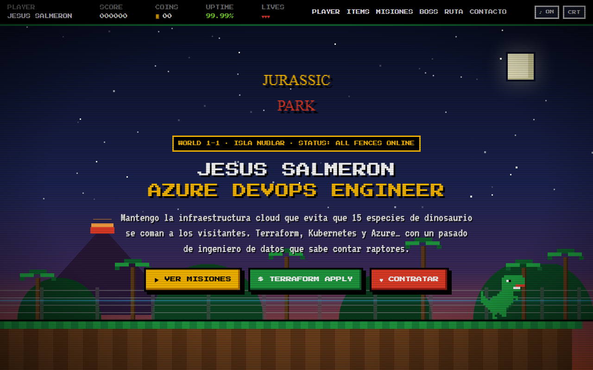

<p align="center">
  
</p>

<p align="center">
  <a href="https://salmerondevzone.github.io"></a>
  <a href="https://www.linkedin.com/in/jesussalmeronarmario/"></a>
  <a href="mailto:jsalmedev@gmail.com"></a>
</p>

## 👋 About me

I'm a **Data Engineer at T-Systems Iberia** moving into **DevOps & Platform Engineering**. I like building things the DevOps way: infrastructure as code, automated pipelines, containers and observability, mostly on **Azure**.

Coming from data (Microsoft Fabric, Power BI, PySpark) gives me an unusual edge: I design infrastructure thinking about the pipelines that will run on it and the metrics someone will check at 3 AM.

```yaml
# whoami.yaml
name: Jesús Salmerón
day_job: Data Engineer @ T-Systems Iberia
heading_to: DevOps / Platform Engineering
focus: [Azure, Terraform, Kubernetes, CI/CD, Observability]
currently_building: Azure Lab   # a local Azure simulator to learn DevOps
ask_me_about: [IaC, pipelines (data or delivery), AKS, cloud costs]
```

## 🚀 Featured work

<table>
  <tr>
    <td width="50%" valign="top">
      <a href="https://github.com/SalmeronDevZone/azure-lab"></a>
      <h3><a href="https://github.com/SalmeronDevZone/azure-lab">☁️ Azure Lab</a></h3>
      <p><b>A private Azure to learn DevOps</b>: no account, no credit card, no bill. A local simulator with the Azure portal, Cloud Shell (<code>az</code>, <code>kubectl</code>, <code>terraform</code>, <code>git</code>, <code>docker</code>), Azure DevOps with YAML pipelines, and a 13-level academy with 47 labs that grade themselves.</p>
      <p>
        
        
        
        
      </p>
      <p>Run it: <code>docker compose up -d --build</code> · UI in Spanish</p>
    </td>
    <td width="50%" valign="top">
      <a href="https://salmerondevzone.github.io"></a>
      <h3><a href="https://salmerondevzone.github.io">🦖 Jurassic Park · DevOps Edition</a></h3>
      <p><b>My portfolio as a retro game</b>: the park's ops division keeping Isla Nublar online with Terraform, Kubernetes and Azure. Character sheet, stack inventory, a missions map and a blameless post-mortem boss fight.</p>
      <p>
        
        
        
        
      </p>
      <p>Live at <a href="https://salmerondevzone.github.io">salmerondevzone.github.io</a> · in Spanish</p>
    </td>
  </tr>
</table>

## 🧰 Tech stack

<p align="center">
  
  <br/>
  
</p>

| Area | Tools |
| --- | --- |
| ☁️ **Cloud & IaC** | Azure · Terraform · Key Vault · Entra ID |
| 📦 **Containers & GitOps** | Docker · Kubernetes (AKS) · Helm · Argo CD |
| 🔁 **CI/CD** | Azure DevOps Pipelines · Git |
| 📈 **Observability & security** | Prometheus · Grafana · Azure Monitor / Log Analytics · Trivy · RBAC & PIM |
| 🐧 **OS & scripting** | Linux · Bash · Python |
| 🧪 **Data** (where I come from) | PySpark · Microsoft Fabric · Power BI · SQL Server · PostgreSQL · MySQL · Oracle |
| 💻 **Also** | Java · .NET · Kotlin |

## 🗂️ More repositories

| Repository | What's inside |
| --- | --- |
| [Insight_Horizon](https://github.com/SalmeronDevZone/Insight_Horizon) | Data pipelines feeding analytics, dashboards and business insights |
| [snake-data-lair](https://github.com/SalmeronDevZone/snake-data-lair) | Python & SQL playground: data ingestion, transformations and experiments |
| [bits-and-bytes](https://github.com/SalmeronDevZone/bits-and-bytes) | Code snippets and mini-projects focused on automation and best practices |
| [PythonProjects](https://github.com/SalmeronDevZone/PythonProjects) | Python scripts for automation, data processing and ETL tasks |
| [GitHub](https://github.com/SalmeronDevZone/GitHub) | Git notes and guides for technical and non-technical profiles |

## 🤝 Let's connect

Happy to talk about Azure, Terraform, Kubernetes and CI/CD, or about data platforms.

<p>
  <a href="https://www.linkedin.com/in/jesussalmeronarmario/"></a>
  <a href="mailto:jsalmedev@gmail.com"></a>
  <a href="https://salmerondevzone.github.io"></a>
  <a href="https://kaggle.com/jesssalmern"></a>
  <a href="https://leetcode.com/mrsaylar"></a>
</p>

<p align="center"><sub>⭐ If <a href="https://github.com/SalmeronDevZone/azure-lab">Azure Lab</a> helps you learn, a star is always appreciated.</sub></p>
